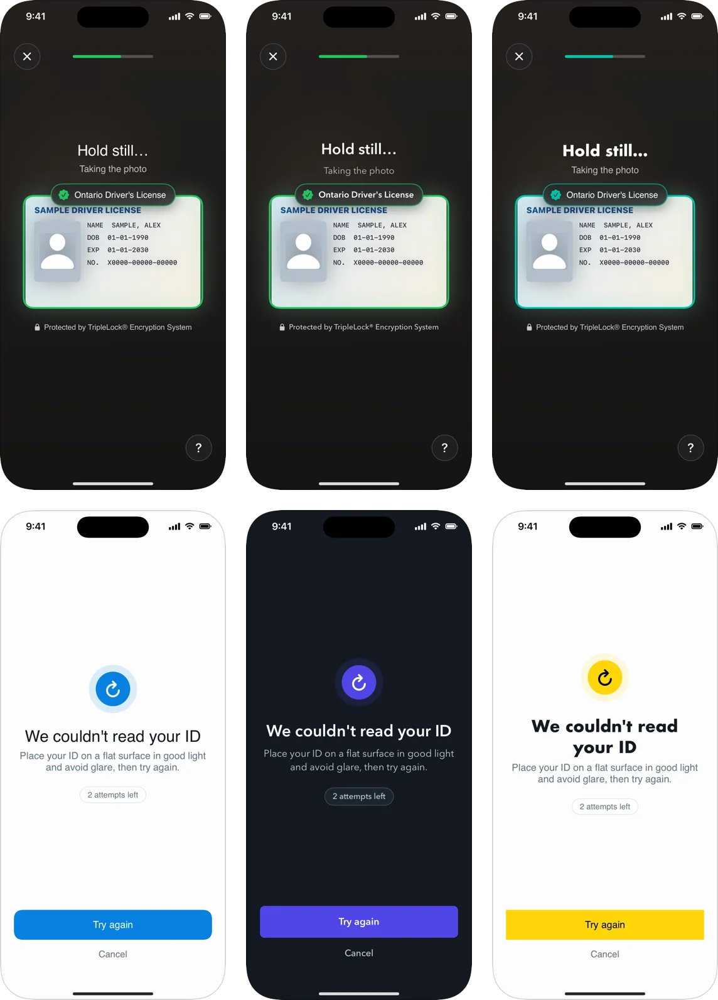
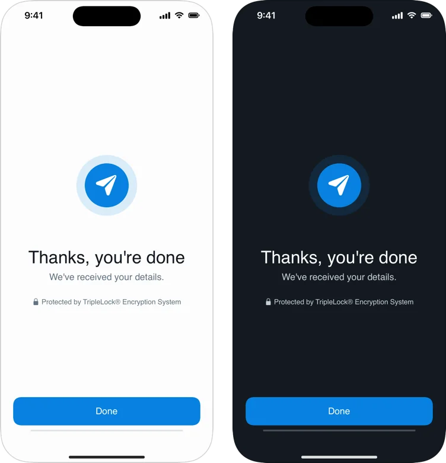

Apply `.deepIDVAppearance(_:)` to any SDK view. It reaches every screen that view shows.

```swift
DeepIDVWorkflowView(client: client, sessionID: sessionID) { result in /* … */ }
    .deepIDVAppearance(DeepIDVAppearance(
        accentColor: Color(red: 0.31, green: 0.27, blue: 0.90),
        fontFamily: "Avenir Next",
        cornerRadius: 8
    ))
```

<Frame caption="The same two screens: deepidv default, an indigo dark brand with Avenir Next, and a yellow light brand with square corners and a Futura heading.">
  
</Frame>

## Options

Every option is optional. Anything left `nil` keeps the deepidv default.

| Option | Type | Used for |
|---|---|---|
| `accentColor` | `Color?` | Buttons, progress, and the frame while a document or face lines up. |
| `successColor` | `Color?` | Ticks, the frame once it's ready, and the liveness ring. |
| `warningColor` | `Color?` | Something needs the user: the wrong document, an upside-down card. |
| `errorColor` | `Color?` | Something can't be used, such as a health card. |
| `fontFamily` | `String?` | All text, by the font's registered family name. |
| `headingFontFamily` | `String?` | Titles. Overrides `fontFamily` for them. |
| `cornerRadius` | `CGFloat?` | Buttons, in points. Cards round a little more. `0` gives square corners. |
| `colorScheme` | `ColorScheme?` | `.light` or `.dark` for the screens outside the camera. `nil` follows the system. |

## What stays fixed, and why

| Element | Why |
|---|---|
| Camera screens are always dark | The frame, messages and oval need contrast over any camera image. |
| The document frame keeps the ID-card (or passport) shape | It tells the user how to hold the card, and capture checks the card against it. |
| The face oval's shape and size | The liveness check measures the face against it. |
| Layout, icons and wording | Kept consistent so the capture guidance is tested and predictable. Wording follows the [language](/integrate/sdks/ios/languages). |
| "Protected by TripleLock® Encryption System" | Shown on capture and progress screens. |

## Text on your colors

Text on a color you set turns black or white, whichever reads better on it. A light accent such as yellow gets black text on its buttons; a mid or dark accent keeps white.

## Fonts

Bundle your font files and list them under `UIAppFonts` in your app's `Info.plist`. Use the **family** name (for example `Avenir Next`), not a file name. A family iOS can't find falls back to the system font, so check every screen after you change fonts. Text sizes follow Dynamic Type.

## Light and dark

<Frame caption="The closing screen in light and dark.">
  
</Frame>

Without `colorScheme`, the SDK follows the system setting. Set it when your app has a fixed appearance.

## Theme your whole flow

Put the modifier on the view you present. For UIKit, apply it inside the `UIHostingController`'s root view:

```swift
let root = DeepIDVWorkflowView(client: client, sessionID: sessionID) { _ in }
    .deepIDVAppearance(.init(accentColor: .indigo))
present(UIHostingController(rootView: root), animated: true)
```
