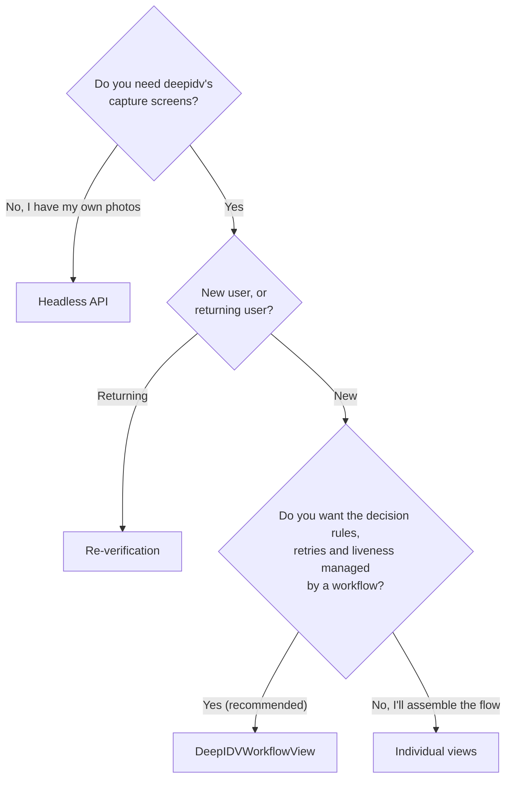

The SDK offers three levels. Most apps should use a workflow.

| | Workflow | Individual views | Headless API |
|---|---|---|---|
| **Entry point** | `DeepIDVWorkflowView` | `DocumentScannerView`, `SelfieCaptureView`, `CustomFaceLivenessView`, `DeepIDVVerificationView` | `scanDocument`, `verifyIdentity`, `checkMovementLiveness` |
| **Screens** | All of them, including retries, progress and the closing screen | The capture screens; you build the rest | None |
| **Rules** | Set per workflow in the Admin Console: documents accepted, attempts, liveness type, auto-decisions | Yours | Yours |
| **Face liveness** | Yes, as a workflow step | `CustomFaceLivenessView`, with a workflow session | `checkMovementLiveness`, with your own camera |
| **Result in the Admin Console** | One session with every step, reviewable | Depends on the call | Per call |
| **Best for** | New-user onboarding, KYC | An existing flow that needs one capture step | Photos from another source, server-like use |

## When to use each

**Workflow.** You want verification to work end to end with the least code, and you want to change rules (accepted documents, attempt limits, liveness) without an app release. → [Run a workflow](/integrate/sdks/ios/workflows/run-a-workflow)

**Re-verification.** The user already passed verification on a workflow, and you want to confirm it's them again (a login step-up, a payout, a kiosk check-in). → [Re-verification](/integrate/sdks/ios/re-verification)

**Individual views.** You already have an onboarding flow and want deepidv's document camera or selfie screen in one step of it. → [Document capture](/integrate/sdks/ios/document-capture), [Selfie](/integrate/sdks/ios/selfie), [Face liveness](/integrate/sdks/ios/face-liveness), [Drop-in verification](/integrate/sdks/ios/drop-in-verification)

**Headless.** You capture images yourself, or receive them from elsewhere, and only need the analysis. → [Headless API](/integrate/sdks/ios/headless/document-and-identity)

## Combining them

The levels share one `DeepIDVClient`. A common pattern is a workflow for onboarding and re-verification for later check-ins, both on the same workflow ID so re-verification can match the face from onboarding.
