The document camera shows one instruction at a time. The frame changes color as the capture goes: white while searching, blue while adjusting, amber when something needs the user, red for a document that can't be used, green when it's ready.

Screenshots are iPhone, with the deepidv default look. Your [branding](/integrate/sdks/ios/branding) changes the colors and fonts.

## Before the camera

<Frame>
  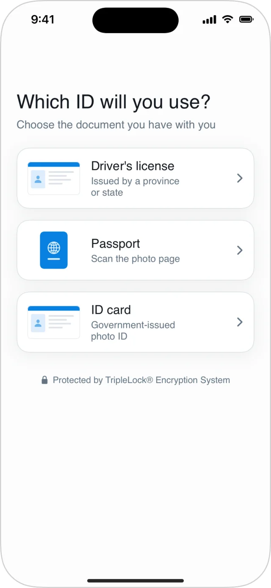
  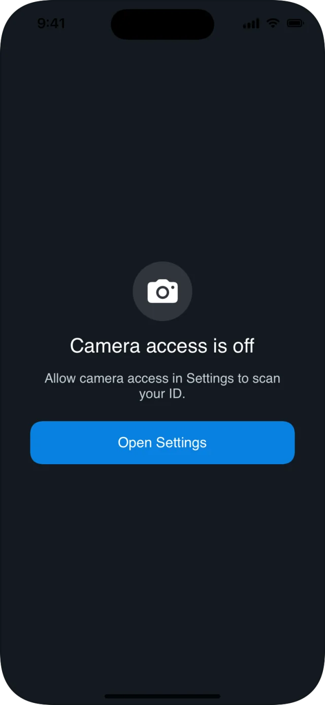
</Frame>

| Screen | When | Your app receives |
|---|---|---|
| **Which ID will you use?** | In workflows, before each document. Lists only the types the workflow accepts; skipped when there's just one. A second document shows **Now choose your secondary ID**. | Nothing |
| **Camera access is off** | The user denied camera access. **Open Settings** opens your app's settings. | `.failure`, kind `.cameraPermissionDenied` |

## Finding and lining up the card

<Frame>
  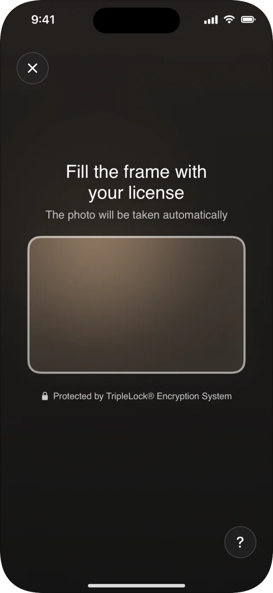
  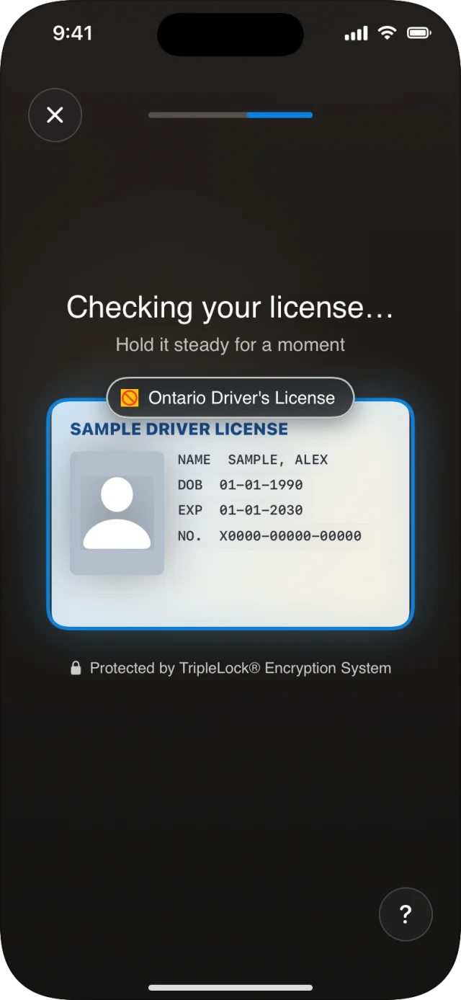
  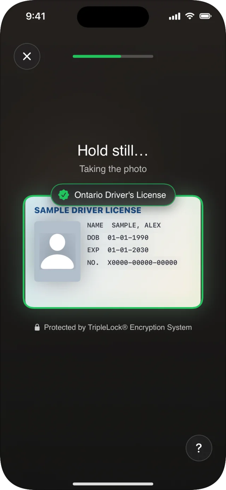
</Frame>

| State | Message | Frame |
|---|---|---|
| Searching | **Fill the frame with your license** · The photo will be taken automatically | White |
| Recognizing (workflows) | **Checking your license…** · Hold it steady for a moment. The document's name appears above the frame once recognized. | Blue |
| Ready | **Hold still…** · Taking the photo, with a progress bar | Green |

## Adjustments

<Frame caption="Move closer, fit in the frame, avoid glare, turn sideways.">
  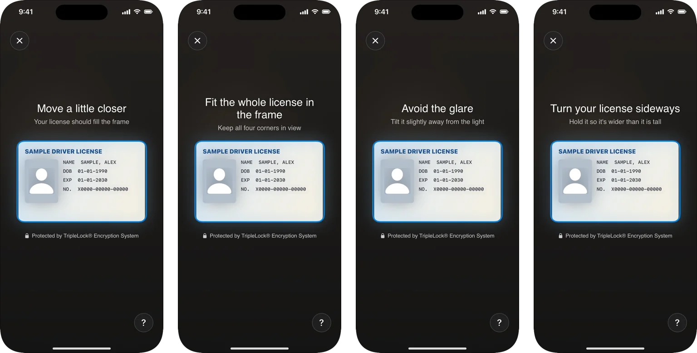
</Frame>

| State | Message | Cause |
|---|---|---|
| Too far | **Move a little closer** · Your license should fill the frame | The card covers too little of the frame. |
| Off the frame | **Fit the whole license in the frame** · Keep all four corners in view | The card's shape doesn't match, often because it's tilted or partly out of view. |
| Glare | **Avoid the glare** · Tilt it slightly away from the light | Too much of the card is washed out. |
| Sideways | **Turn your license sideways** · Hold it so it's wider than it is tall | A card held portrait. Not shown for passports. |

## Needs the user (workflows)

<Frame>
  
  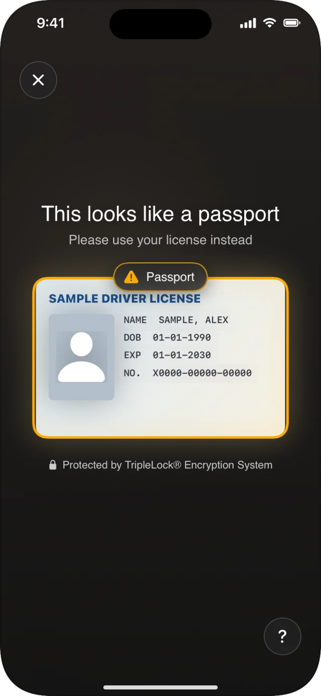
  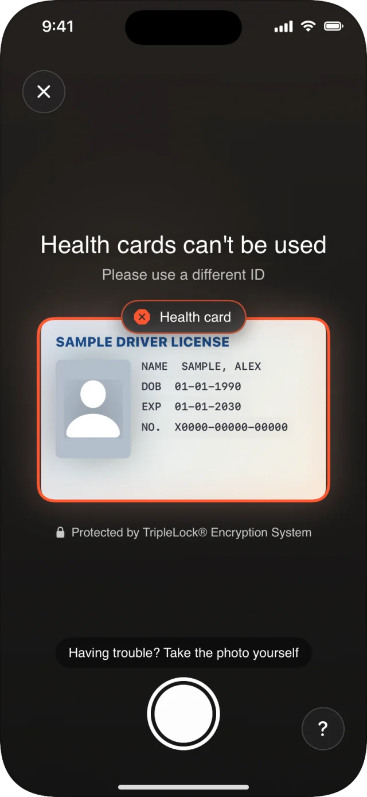
</Frame>

| State | Message | Capture |
|---|---|---|
| Upside down | **Your license is upside down** · Turn it the right way up | Waits until it's turned. |
| Wrong document | **This looks like a passport** · Please use your license instead | Never automatic. The manual shutter still works. |
| Health card | **Health cards can't be used** · Please use a different ID | Never automatic. The manual shutter still works. |

## Captured, flip, done

<Frame>
  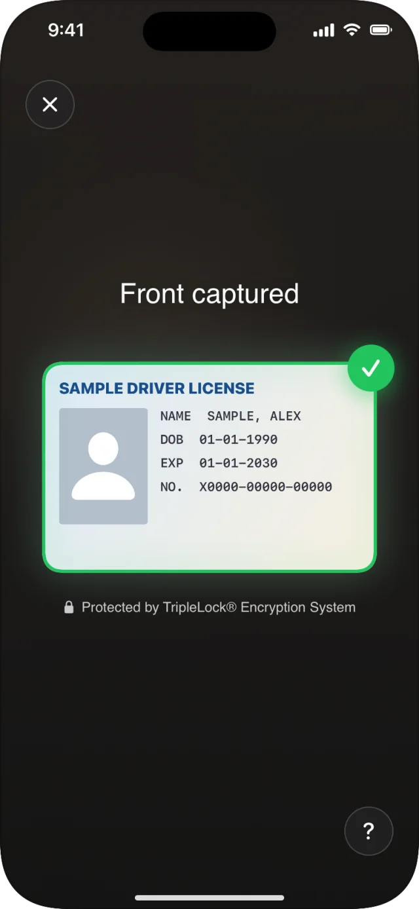
  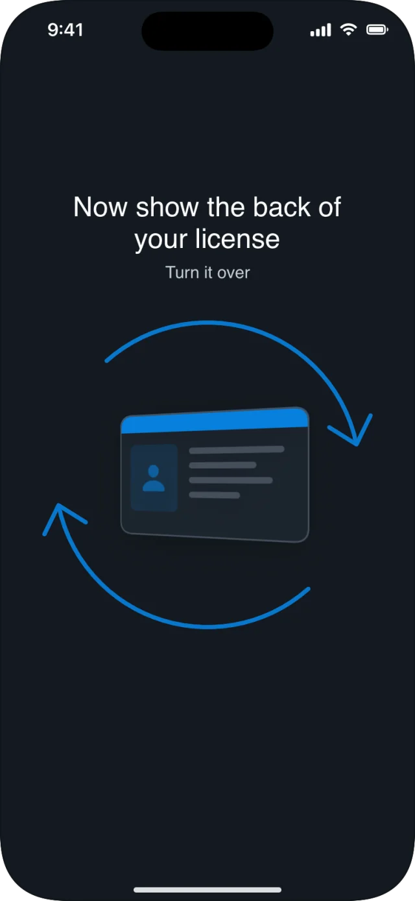
  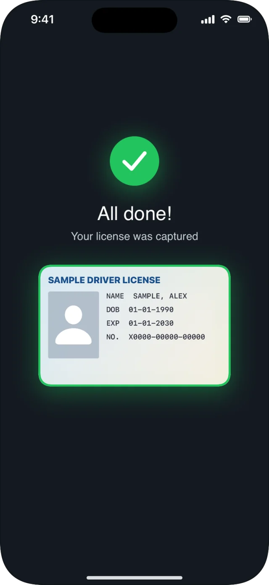
</Frame>

| State | Message | Notes |
|---|---|---|
| Front captured | **Front captured**, with a tick | Shown briefly. |
| Flip | **Now show the back of your license** | Cards only. The back is armed after 2 s, or as soon as the card leaves the frame. |
| Back | **Fill the frame with the back of your license** | |
| Done | **All done!** · Your license was captured | Then the photos upload. |

## Passports

<Frame>
  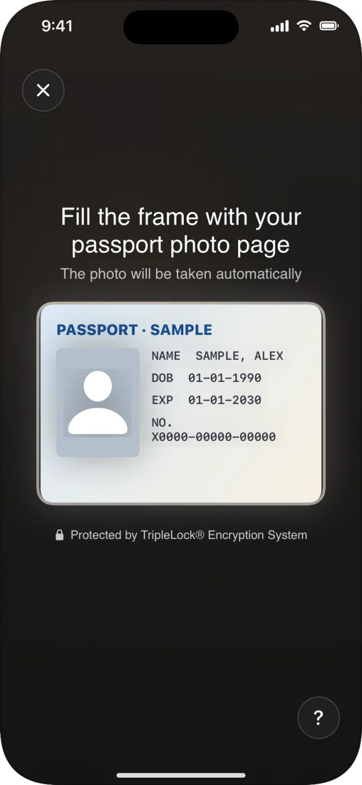
</Frame>

The frame takes the shape of the photo page. Only the photo page is captured, with no flip. In workflows it's captured once it has been in view and steady for 1.5 seconds.

## Help and the manual shutter

<Frame>
  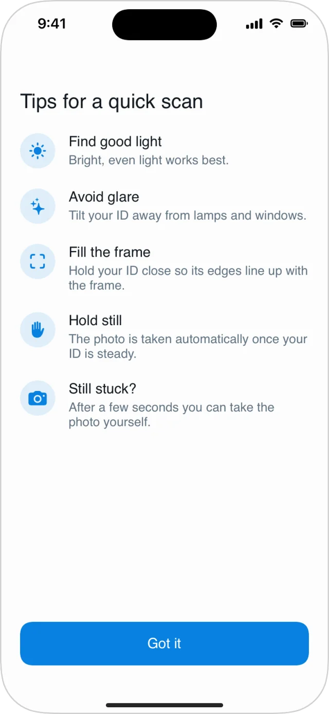
</Frame>

- The **?** button opens **Tips for a quick scan**.
- **Having trouble? Take the photo yourself** and a shutter button appear 8 seconds after a card first comes into view, or 15 seconds into the side at the latest. A manual photo goes through the same checks on deepidv's side.
- The **✕** button closes the camera. Your app receives `.failure` with kind `.cancelled`.

## Accessibility

- Each new instruction is announced by VoiceOver, and the capture has haptic feedback.
- With Reduce Motion on, animations are replaced by simple fades.
- Messages are in English, Spanish or French. See [Languages](/integrate/sdks/ios/languages).

## Guidance for your users

Put this in your own onboarding or help pages:

| Do | Don't |
|---|---|
| Use bright, even light | Stand under a single strong lamp or in direct sun |
| Lay the card flat or hold it steady | Move the card while the bar fills |
| Fill the frame edge to edge | Hold the card far away or at an angle |
| Tilt it slightly if there's glare | Cover the card with fingers |
| Remove the card from a sleeve or wallet | Use a photo of a card, or a screen |

## On iPad

<Frame caption="The same screen on a 12.9-inch iPad in landscape.">
  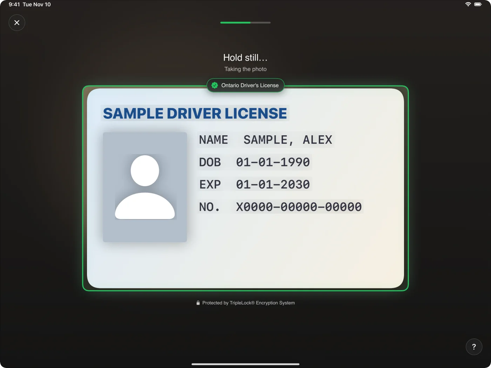
</Frame>

The frame keeps the card's shape and scales to the screen. If the iPad is turned during a scan, capture continues and the photo is sent whole instead of cut to the frame.
