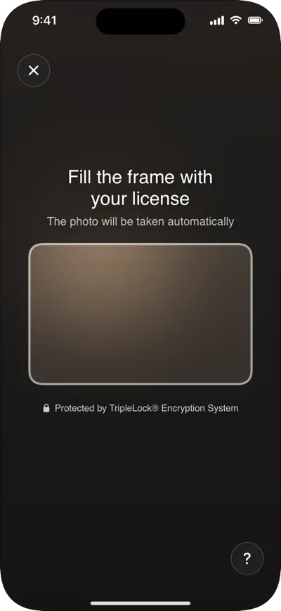

The document camera guides the user to a sharp, glare-free photo of their ID and takes it automatically. It's the first part of every ID verification step in a [workflow](/integrate/sdks/ios/workflows/run-a-workflow), and it's also available on its own as `DocumentScannerView`.

<Frame caption="Searching, recognizing, holding still, captured.">
  
</Frame>

## What it does

| Capability | Workflows | `DocumentScannerView` |
|---|---|---|
| Guidance: move closer, fit in frame, reduce glare, turn to landscape, hold still | ✓ | ✓ |
| Automatic capture once the card is steady | ✓ | ✓ |
| Manual shutter if auto-capture hasn't fired (after 8 s with a card in view, 15 s at most) | ✓ | ✓ |
| Front then back for cards; front only for passports | ✓ | ✓ |
| **Recognizes the document** and shows its name ("Ontario Driver's License") | ✓ | — |
| Waits while a card is **upside down** | ✓ | — |
| Asks for a different ID when the card isn't the type chosen (**"This looks like a passport"**) | ✓ | — |
| Never auto-captures a **health card** | ✓ | — |
| Passport photo page captured once steady for 1.5 s | ✓ | — |
| Photo cut to the on-screen frame, up to 12 MP | ✓ | ✓ |

Recognition runs on deepidv's servers during capture and needs a workflow session, so it's only in workflows. If recognition isn't reachable (for example, a [proxy](/integrate/sdks/ios/proxy-mode) that doesn't forward `/id-capture/detect`), capture carries on with the on-device checks. It never blocks capture.

To turn recognition off, set `usesDocumentClassifier` to `false` in [`DeepIDVConfig`](/integrate/sdks/ios/reference/configuration).

## In a workflow

Nothing to add: `DeepIDVWorkflowView` shows the document picker (only the types the workflow accepts), then the camera, for each document the workflow asks for. See [Screens and states](/integrate/sdks/ios/document-capture-screens) for everything the user can see.

## On its own: `DocumentScannerView`

Captures a document, uploads it and returns the fields read from it.

```swift
DocumentScannerView(client: client, documentType: .driversLicense) { result in
    switch result {
    case .success(let scan):
        print(scan.fullName, scan.documentNumber, scan.expirationDate)
        print("confidence (0–1):", scan.confidence)
    case .failure(let error):
        if error.kind == .cancelled { return }
        print("scan failed:", error.kind)
    }
}
```

| Parameter | Type | Default | Description |
|---|---|---|---|
| `client` | `DeepIDVClient` | required | |
| `documentType` | `DocumentType` | required | `.driversLicense`, `.idCard` or `.passport`. Decides front-and-back or front only. `.auto` isn't accepted by capture views. |
| `documentCamera` | `DocumentCamera?` | `nil` | `.front` or `.back` for this view; `nil` uses `DeepIDVConfig.documentCamera`. |
| `onResult` | `(Result<DocumentScanResult, DeepIDVError>) -> Void` | required | Called once. |

To let the user choose the type first, show `DocumentTypePicker(onSelect:)` and pass its choice in.

### `DocumentScanResult`

| Property | Type | Notes |
|---|---|---|
| `documentType` | `String` | As read from the document. |
| `fullName`, `firstName`, `lastName` | `String` | |
| `dateOfBirth`, `expirationDate` | `String` | As printed; parse with care. |
| `gender`, `nationality`, `issuingCountry` | `String` | |
| `documentNumber` | `String` | |
| `address` | `String?` | |
| `mrzData` | `String?` | Passports. |
| `rawFields` | `[String: String]` | Every field read. |
| `confidence` | `Double` | **0 to 1.** |
| `frontImageKey`, `backImageKey` | `String`, `String?` | Keys of the uploaded photos. |

### Errors

| Kind | When |
|---|---|
| `.cancelled` | The user closed the camera. |
| `.cameraPermissionDenied` | Camera access is off. The view also offers **Open Settings**. |
| `.captureFailed` | The camera couldn't start or take a photo. |
| `.network`, `.timeout`, `.serviceUnavailable` | The upload or scan didn't complete. |
| `.validation` | The photo was rejected (format or size). |

## The photo that's uploaded

- Taken at the largest size the camera offers, up to 12 MP (4032 × 3024).
- Cut to the frame drawn on screen, with a small margin, so nothing around the card (such as the face of the person holding it) is uploaded.
- In workflows, two extra frames taken just before the photo go with it. deepidv reads them only when the photo leaves the expiry date or date of birth unreadable, then deletes them.

## Camera

On a phone, use the back camera (`.back`). On a kiosk or tablet facing the user, use the front camera (`.front`, the default). Document capture turns Center Stage off on iPads that have it, so the camera doesn't reframe the card, and restores it afterwards. See [Camera](/integrate/sdks/ios/camera).

## Related

- [Screens and states](/integrate/sdks/ios/document-capture-screens): every screen, what triggers it, and capture guidance for your users
- [Branding](/integrate/sdks/ios/branding): colors and fonts on these screens
- [Troubleshooting](/integrate/sdks/ios/troubleshooting): auto-capture never fires, recognition missing
