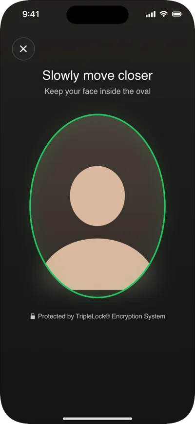
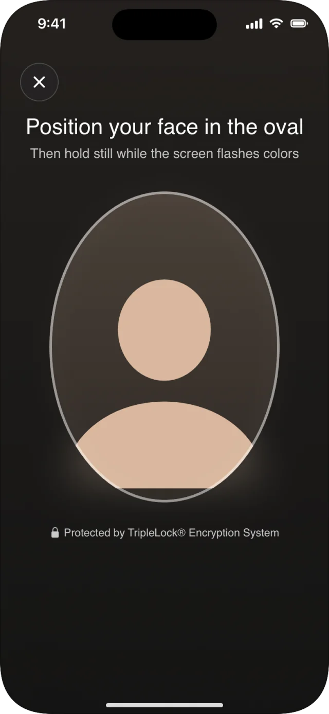
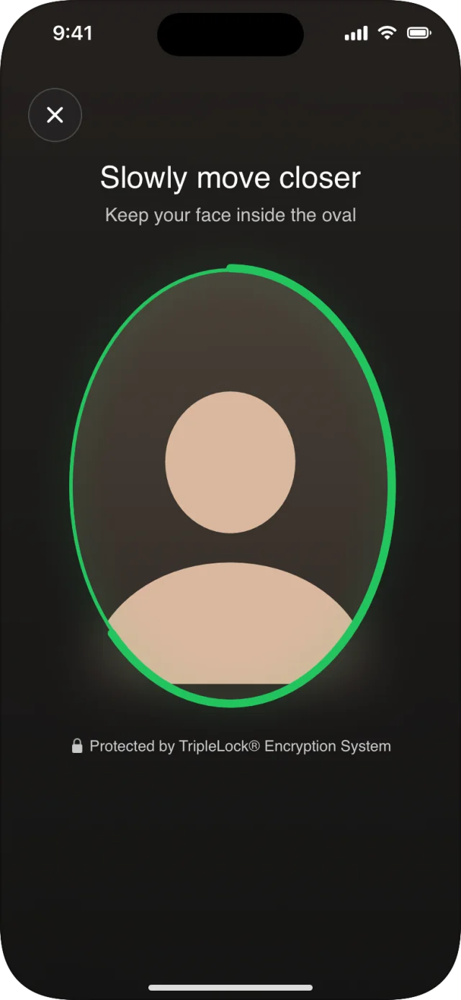
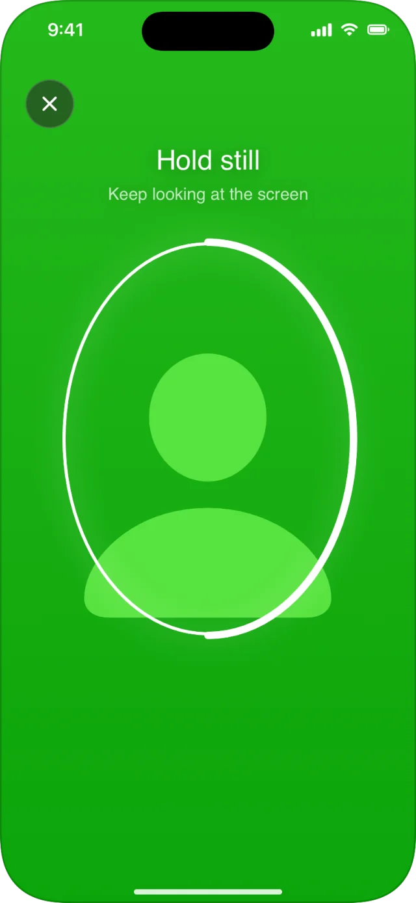
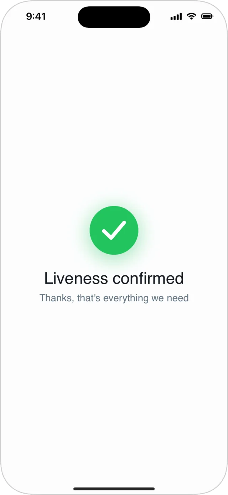

Face liveness checks that a real person is in front of the camera, not a photo, a screen or a mask. The user moves closer to the camera; with the light challenge, the screen also flashes a short sequence of colors. deepidv scores the capture and decides whether it passed.

<Frame caption="The ring fills as the user moves closer.">
  
</Frame>

## Three ways to run it

| | How | Use when |
|---|---|---|
| **Workflow step** (recommended) | Add a **face liveness** step to the workflow; `DeepIDVWorkflowView` runs it. | Onboarding with ID and liveness. |
| **`CustomFaceLivenessView`** | Present the view with a workflow session whose current step is face liveness. | You run the ID part some other way. |
| **Headless** | `checkMovementLiveness` with frames from your own camera. | You must use your own camera screen. See [Liveness with your own camera](/integrate/sdks/ios/headless/liveness). |

The challenge type (movement, or movement and light) and the pass threshold are set on the workflow step, not in the app.

## Screens and states

<Frame>
  
  
  
  
</Frame>

| State | Message |
|---|---|
| Getting ready | **Getting ready** · Next, a quick check that it's really you |
| Before the light challenge | **Position your face in the oval** · Then hold still while the screen flashes colors |
| Before the movement challenge | **Position your face in the oval** · Look straight at the screen |
| Moving closer | **Slowly move closer** · Keep your face inside the oval, with the ring filling |
| Too close | **Move back a little** · Your whole face should fit in the oval |
| Before the flashes | **Hold still** · The screen will flash a few colors |
| Flashing | **Hold still** · Keep looking at the screen, with the screen tinted |
| Passed | **Liveness confirmed** (standalone view) |
| Not passed | **We couldn't verify you**, with **Try again** |

<Warning>
  The light challenge flashes the screen with bright colors. The user is warned before it starts. If your users may be sensitive to flashing light, use the movement-only challenge on the workflow step.
</Warning>

## `CustomFaceLivenessView`

```swift
CustomFaceLivenessView(client: client, sessionID: sessionID) { result in
    switch result {
    case .success(let liveness):
        // A check that ran but didn't pass is a success with passed == false.
        print(liveness.status, liveness.passed, liveness.confidence ?? 0)
    case .failure(let error):
        // Permission, cancellation, capture or network.
        print("liveness error:", error.kind)
    }
}
```

| Parameter | Type | Description |
|---|---|---|
| `client` | `DeepIDVClient` | |
| `sessionID` | `String` | A workflow session whose **current** step is face liveness. Out of order fails with `.conflict`. |
| `onResult` | `(Result<FaceLivenessResult, DeepIDVError>) -> Void` | Called once. |

### `FaceLivenessResult`

| Property | Type | Meaning |
|---|---|---|
| `status` | `.succeeded`, `.inProgress`, `.failed` | The check's state. |
| `passed` | `Bool` | Computed by deepidv against the workflow's threshold. |
| `confidence` | `Double?` | **0 to 100.** `nil` on a failed workflow attempt. |

No images come back to the app.

## Guidance for your users

- Use a well-lit room, and face the light.
- Hold the phone at eye level and move it, or your head, slowly toward each other.
- Keep the whole face in the oval; take off sunglasses.
- During the flashes, keep still and keep looking at the screen.

## Related

- [Re-verification](/integrate/sdks/ios/re-verification) uses the same check to confirm a returning user.
- [Failures and retries](/integrate/sdks/ios/workflows/failures): `.livenessFailed`, `.livenessIDMismatch`
