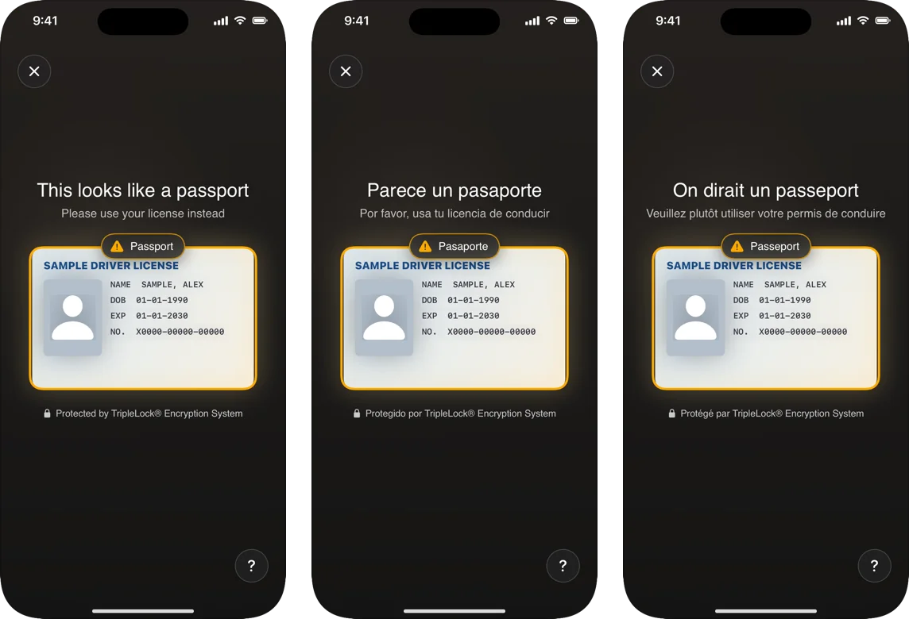

The SDK's screens are available in **English**, **Spanish** and **French**.

<Frame caption="The same message in English, Spanish and French.">
  
</Frame>

## How the language is chosen

1. `DeepIDVConfig.language`, if you set it.
2. Otherwise, the first of the user's preferred languages (**Settings > General > Language & Region**) that the SDK has.
3. Otherwise, English.

The SDK chooses the language itself. Your app doesn't need to list Spanish or French in its own localizations for the SDK's screens to use them.

## Set it explicitly

If your app has its own language setting, pass it so the SDK matches:

```swift
let client = DeepIDVClient(config: DeepIDVConfig(
    apiKey: userToken,
    baseURL: proxyURL,
    language: .spanish        // .english, .spanish, .french, or nil to follow the device
))
```

<Note>
  The language applies to the whole app process. If you create several clients with different languages, the one created last wins. Use one client, or give all clients the same language.
</Note>

## What's translated

Every line the SDK shows: instructions, document names on the capture screen, buttons, errors, retries, the closing screen and VoiceOver announcements. A document's official name keeps its own spelling (for example "UK Driving Licence").

Your own copy around the SDK (for example the screen after `onResult`) is yours to translate. The SDK's `DeepIDVError.message` and `WorkflowFailure.message` are developer strings in English; don't show them to users.

## Custom wording

The SDK's wording can't be changed yet. If you need different wording for your product, contact [support](mailto:support@deepidv.com).
