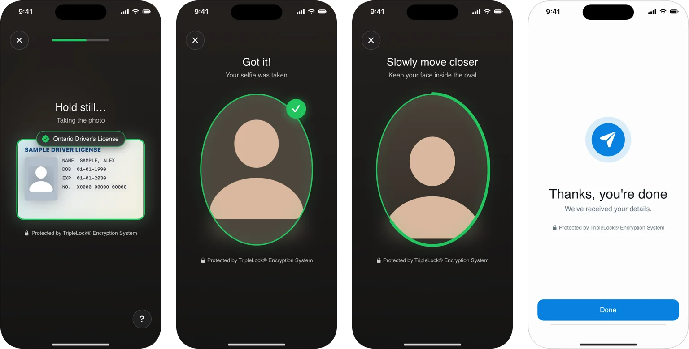
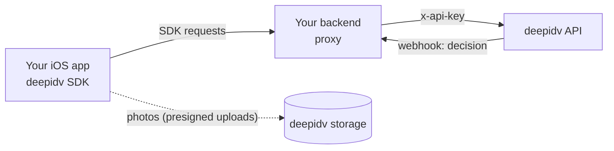

The deepidv iOS SDK puts identity verification inside your app. It ships the capture screens your users see (ID document, selfie, face liveness) and the calls behind them, so a complete verification is one SwiftUI view.

<Frame caption="A workflow on iPhone: ID capture, selfie, face liveness, and the closing screen.">
  
</Frame>

## What's included

| Area | What you get |
|------|--------------|
| [Workflows](/integrate/sdks/ios/workflows/run-a-workflow) | `DeepIDVWorkflowView` runs a verification workflow you built in the Admin Console, step by step: ID verification (up to three documents), face liveness, retries, resuming and a closing screen. |
| [Document capture](/integrate/sdks/ios/document-capture) | Guided capture of ID cards, driver's licenses and passports. Recognizes the document, catches a card held upside down, refuses health cards, captures automatically and falls back to a manual shutter. |
| [Selfie](/integrate/sdks/ios/selfie) | A front-camera selfie with face guidance. |
| [Face liveness](/integrate/sdks/ios/face-liveness) | A native liveness check (head movement, optionally with a colored-light sequence), scored by deepidv. |
| [Re-verification](/integrate/sdks/ios/re-verification) | Confirms a returning user is the same person, with their face. |
| [Drop-in verification](/integrate/sdks/ios/drop-in-verification) | ID and selfie in one view, without a workflow. |
| [Headless API](/integrate/sdks/ios/headless/document-and-identity) | `async` methods for images you captured yourself: document scan, identity verify, liveness and iGaming checks. |
| [Branding](/integrate/sdks/ios/branding) and [languages](/integrate/sdks/ios/languages) | Your colors, fonts and corner radius; English, Spanish and French. |

## Requirements

- iOS 15 or later
- Xcode 26 or later (Swift 6.2)
- `NSCameraUsageDescription` in your app's `Info.plist`
- No third-party dependencies: the SDK uses Apple frameworks only

## How it fits together

Your app runs the screens. Your backend holds the deepidv API key, creates sessions, and receives the decision.

- The SDK never needs your secret API key on the device. Route its requests through your backend, which adds the key. See [Security and API keys](/integrate/sdks/ios/security-and-api-keys).
- Photos upload straight to deepidv storage through short-lived presigned URLs, so your backend doesn't carry images.
- The decision reaches your backend through [webhooks](/webhooks/overview) and `GET /v1/sessions/{id}`. The SDK's result is for your UI, not for granting access.

## What do you want to do?

| Goal | Start here |
|------|-----------|
| Verify a new user with ID and face | [Quickstart](/integrate/sdks/ios/quickstart), then [Run a workflow](/integrate/sdks/ios/workflows/run-a-workflow) |
| Pick the right integration | [Choose an integration](/integrate/sdks/ios/choose-an-integration) |
| Confirm a returning user | [Re-verification](/integrate/sdks/ios/re-verification) |
| Build your own screens around our capture | [Document capture](/integrate/sdks/ios/document-capture), [Selfie](/integrate/sdks/ios/selfie), [Face liveness](/integrate/sdks/ios/face-liveness) |
| Use photos you already have | [Headless API](/integrate/sdks/ios/headless/document-and-identity) |
| Match your brand | [Branding](/integrate/sdks/ios/branding) |
| Ship safely | [Security and API keys](/integrate/sdks/ios/security-and-api-keys), [Proxy mode](/integrate/sdks/ios/proxy-mode) |
| Let an AI assistant do the integration | [Build with AI](/integrate/sdks/ios/ai-agents) |

## Source and releases

The SDK is open source under the MIT license: [github.com/Deep-Identity-Inc/deepidv-sdk-swift](https://github.com/Deep-Identity-Inc/deepidv-sdk-swift). Every release is listed in the [changelog](/integrate/sdks/ios/reference/changelog).
