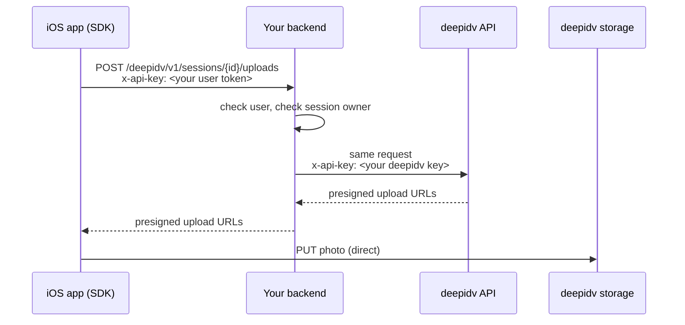

In proxy mode the SDK talks to **your** backend. Your backend authenticates your user, checks the request, adds your deepidv API key and forwards it. Photos still upload straight to deepidv storage, so the proxy only carries small JSON requests.



## Configure the SDK

Set `baseURL` to your proxy and pass your app's own user token as `apiKey`. The SDK sends `apiKey` in the `x-api-key` header and appends paths such as `/v1/sessions/{id}/workflow` to `baseURL`, keeping any path you include.

```swift
let client = DeepIDVClient(config: DeepIDVConfig(
    apiKey: userToken,                                     // your token, checked by your proxy
    baseURL: URL(string: "https://api.example.com/deepidv")!
))
```

If your user token expires, create a new client with a fresh one before you present the next SDK view.

## Endpoints to forward

Forward only what your integration uses. Everything else should get a `404` from your proxy.

| Feature | Method and path | Notes |
|---|---|---|
| Workflows | `GET /v1/sessions/{id}/workflow` | Read and resume the session. |
| | `POST /v1/sessions/{id}/workflow/start` | |
| | `POST /v1/sessions/{id}/uploads` | Returns presigned upload URLs. |
| | `POST /v1/sessions/{id}/steps/ID_VERIFICATION` | Step paths use the step ID as-is. |
| | `POST /v1/sessions/{id}/id-capture/detect` | Document recognition during capture. About one call a second, each a JPEG of at most 1280 px as base64. **If you skip it, capture still works but without recognition.** |
| Face liveness (workflow step or standalone view) | `POST /v1/sessions/{id}/steps/face-liveness` | Kebab-case, unlike the ID step. |
| Workflow created by the app | `POST /v1/workflows/{workflow_id}/sessions` | Only if the app creates sessions. Prefer creating them on your backend. |
| Re-verification | `POST /v1/re-verifications` | Body: `workflow_id`, `email`. Replace `email` with your signed-in user's email. |
| | `POST /v1/re-verifications/{id}/liveness/start` | |
| | `POST /v1/re-verifications/{id}/liveness/upload-url` | |
| | `POST /v1/re-verifications/{id}/liveness/complete` | |
| Headless scan and verify | `POST /v1/upload/presign` | |
| | `POST /v1/document/scan` | |
| | `POST /v1/identity/verify` | |
| iGaming | `POST /v1/igaming/anti-cheat` | The face image is in the body (base64): allow larger bodies. |
| | `POST /v1/igaming/vpn-detection` | |
| | `POST /v1/igaming/ip-jurisdiction` | |

Uploads (`PUT`) go to the presigned URLs deepidv returns, not through your proxy. If your network restricts outbound traffic from devices, allow the deepidv storage host those URLs point to.

## Rules your proxy should enforce

1. **Authenticate the user** from the `x-api-key` header (your token). Reject anything else with `401`.
2. **Allow-list the paths** above. Reject the rest with `404`.
3. **Check ownership.** A session ID in the path must be one your backend created for this user. A re-verification ID must be one this user started.
4. **Pin the identity.** On `POST /v1/re-verifications`, overwrite `email` with the signed-in user's email so a user can't re-verify as someone else.
5. **Pass responses through unchanged**, including the status code and the `Retry-After` header. The SDK relies on them for retries and error screens.

## Example: Node.js (Express)

Adapt `authenticate`, `ownsSession` and the storage calls to your app.

```javascript
import express from "express";

const app = express();
const DEEPIDV = "https://api.deepidv.com";
const ID = "[A-Za-z0-9-]+";

const routes = [
  ["GET",  new RegExp(`^/v1/sessions/(${ID})/workflow$`)],
  ["POST", new RegExp(`^/v1/sessions/(${ID})/workflow/start$`)],
  ["POST", new RegExp(`^/v1/sessions/(${ID})/uploads$`)],
  ["POST", new RegExp(`^/v1/sessions/(${ID})/steps/(ID_VERIFICATION|face-liveness)$`)],
  ["POST", new RegExp(`^/v1/sessions/(${ID})/id-capture/detect$`)],
];

app.use("/deepidv", express.raw({ type: "*/*", limit: "15mb" }), async (req, res) => {
  const user = await authenticate(req.get("x-api-key"));           // your own token
  if (!user) return res.sendStatus(401);

  const route = routes.find(([method, re]) => method === req.method && re.test(req.path));
  if (!route) return res.sendStatus(404);

  const sessionId = req.path.match(route[1])[1];
  if (!(await ownsSession(user, sessionId))) return res.sendStatus(403);

  const upstream = await fetch(DEEPIDV + req.originalUrl.replace(/^\/deepidv/, ""), {
    method: req.method,
    headers: {
      "x-api-key": process.env.DEEPIDV_API_KEY,
      "content-type": req.get("content-type") ?? "application/json",
      accept: "application/json",
    },
    body: req.method === "GET" ? undefined : req.body,
  });

  res.status(upstream.status);
  for (const header of ["content-type", "retry-after"]) {
    const value = upstream.headers.get(header);
    if (value) res.set(header, value);
  }
  res.send(Buffer.from(await upstream.arrayBuffer()));
});
```

To support [re-verification](/integrate/sdks/ios/re-verification), add its routes, set `email` from your user on the create call, and record the `re_verification_id` from the response so you can check ownership of the follow-up calls.

## Check it works

- Run a workflow on a device. Your proxy logs should show `GET …/workflow`, `POST …/workflow/start`, `POST …/uploads`, a series of `POST …/id-capture/detect`, then the step submissions.
- If the capture screen never names the card ("Ontario Driver's License"), `…/id-capture/detect` isn't reaching deepidv. See [Troubleshooting](/integrate/sdks/ios/troubleshooting).
