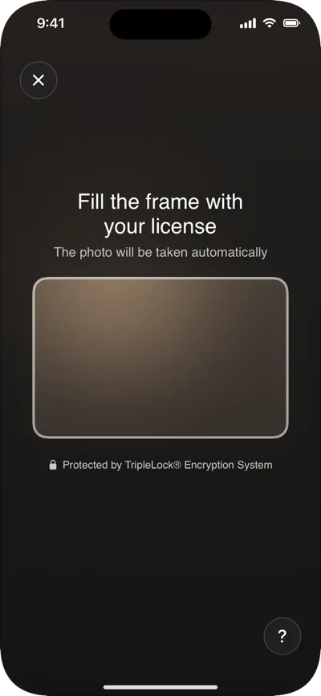

This guide takes you from an empty app to a verification your backend can act on. You need:

- A workflow built in the [Admin Console](https://app.deepidv.com) with an **ID verification** step and, optionally, a **face liveness** step. Copy its workflow ID.
- An API key from [API authentication](/authentication). It stays on your backend.
- An iPhone or iPad running iOS 15 or later. The camera doesn't work in the iOS Simulator.

<Steps>
  <Step title="Add the SDK">
    In Xcode, choose **File > Add Package Dependencies…**, enter `https://github.com/Deep-Identity-Inc/deepidv-sdk-swift`, and add the **DeepIDV** library to your app. Details: [Installation](/integrate/sdks/ios/installation).
  </Step>
  <Step title="Declare camera access">
    Add `NSCameraUsageDescription` to your app's `Info.plist`:

    ```xml
    <key>NSCameraUsageDescription</key>
    <string>Used to scan your ID and take a selfie to verify your identity.</string>
    ```
  </Step>
  <Step title="Create the session on your backend">
    When a user starts verification, your backend creates a workflow session and returns its ID to the app. Remember which user it belongs to.

    ```javascript Node.js
    app.post("/verification/start", requireUser, async (req, res) => {
      const response = await fetch(
        `https://api.deepidv.com/v1/workflows/${process.env.DEEPIDV_WORKFLOW_ID}/sessions`,
        {
          method: "POST",
          headers: {
            "x-api-key": process.env.DEEPIDV_API_KEY,
            "Content-Type": "application/json",
          },
          body: JSON.stringify({
            email: req.user.email,
            first_name: req.user.firstName,
            last_name: req.user.lastName,
            external_id: req.user.id,
          }),
        }
      );
      const { session_id } = await response.json();
      await db.verificationSessions.insert({ sessionId: session_id, userId: req.user.id });
      res.json({ sessionId: session_id });
    });
    ```
  </Step>
  <Step title="Proxy the SDK's requests">
    The SDK calls the deepidv API for the session it runs. Point it at your backend, which checks the user and adds your API key. Copy the proxy from [Proxy mode](/integrate/sdks/ios/proxy-mode).

    <Warning>
      Don't put your deepidv API key in the app. Anything shipped in an app can be extracted from it.
    </Warning>
  </Step>
  <Step title="Present the workflow">
    Create one client, pointed at your proxy, and present `DeepIDVWorkflowView` with the session ID.

    ```swift
    import DeepIDV
    import SwiftUI

    struct VerifyButton: View {
        let client: DeepIDVClient          // created once, see below
        let sessionID: String              // from your backend
        @State private var isVerifying = false

        var body: some View {
            Button("Verify your identity") { isVerifying = true }
                .fullScreenCover(isPresented: $isVerifying) {
                    DeepIDVWorkflowView(client: client, sessionID: sessionID) { result in
                        isVerifying = false
                        switch result {
                        case .success(let run):
                            // The user finished. The decision goes to your backend.
                            print("finished with status", run.sessionStatus.rawValue)
                        case .failure(let error):
                            if error.kind == .cancelled { return }
                            print("verification error:", error.kind)
                        }
                    }
                }
        }
    }

    // Once, for example in your app's environment:
    let client = DeepIDVClient(config: DeepIDVConfig(
        apiKey: userToken,  // your app's own sign-in token; your proxy swaps it for the deepidv key
        baseURL: URL(string: "https://api.example.com/deepidv")!
    ))
    ```

    The view runs every step in the workflow, shows retries when a photo can't be used, and ends on a short thank-you screen before `onResult` fires.
  </Step>
  <Step title="Receive the decision">
    Subscribe to the `session.status.verified` and `session.status.rejected` [webhooks](/webhooks/overview), or read the session with [Retrieve session](/api-reference/sessions/retrieve-session). Grant access from there, not from `onResult`. See [Results and the decision](/integrate/sdks/ios/workflows/results).
  </Step>
</Steps>

<Frame caption="What your user sees: the document camera, then the closing screen.">
  
</Frame>

## Next steps

<CardGroup cols={2}>
  <Card title="Run a workflow" icon="list-checks" href="/integrate/sdks/ios/workflows/run-a-workflow">
    The three ways to start a run, and what each step shows.
  </Card>
  <Card title="Document capture" icon="id-card" href="/integrate/sdks/ios/document-capture">
    Every capture screen and what triggers it.
  </Card>
  <Card title="Branding" icon="palette" href="/integrate/sdks/ios/branding">
    Your colors and fonts on every screen.
  </Card>
  <Card title="Troubleshooting" icon="wrench" href="/integrate/sdks/ios/troubleshooting">
    Fixes for the common problems.
  </Card>
</CardGroup>
