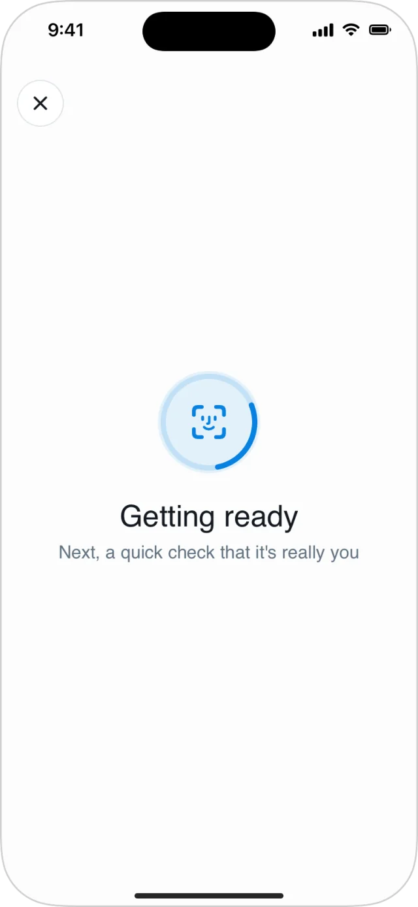
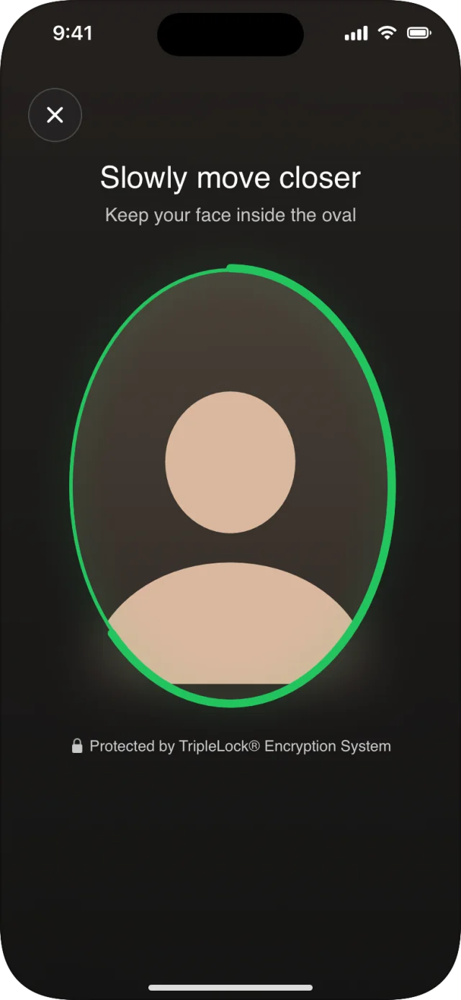
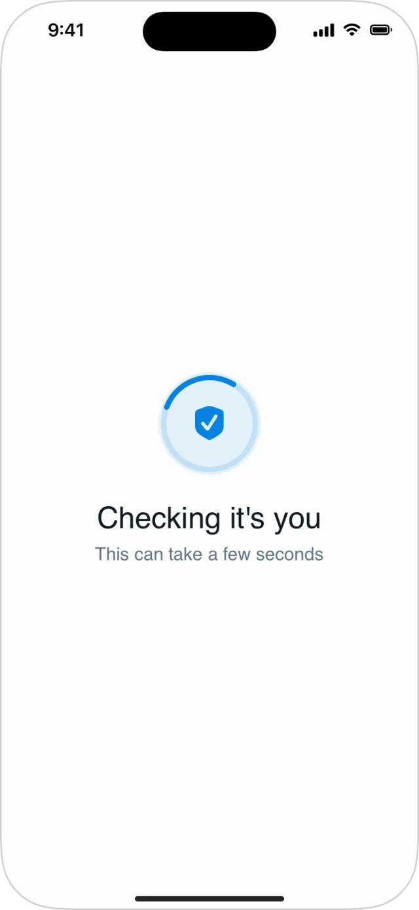
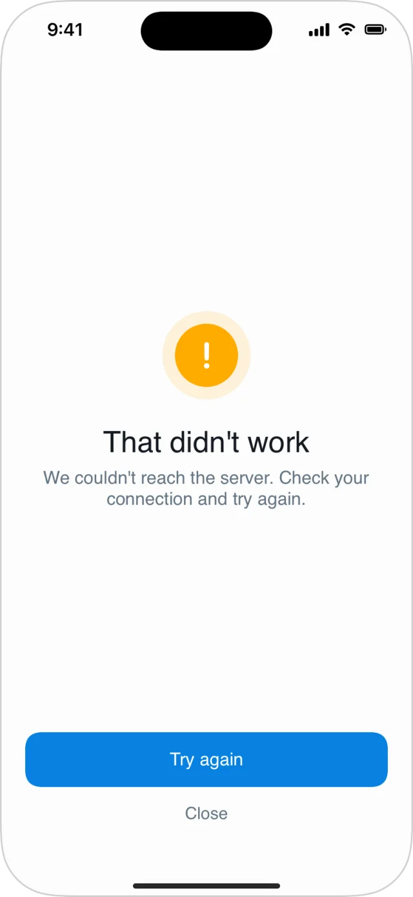

Re-verification confirms that the person in front of the camera is a user who already passed verification. Use it for a login step-up, before a payout, or at a kiosk check-in. The user does a [face liveness](/integrate/sdks/ios/face-liveness) check, and deepidv matches the face against that user's approved sessions.

## Before you start

- **Turn on re-verification** on the workflow in the Admin Console.
- **Enrolment is automatic.** Every session approved on that workflow is enrolled after approval. Nothing in the app registers faces.
- **You name the user.** Pass the email of a user in your organization who was verified on this workflow. The view never asks the user for it. A face that belongs to someone else is not re-verified.

## Present the view

```swift
client.makeReVerifyView(workflowID: "YOUR_WORKFLOW_ID", email: user.email) { result in
    switch result {
    case .success(.verified(let reVerificationID, let originalSessionID, let userID)):
        // It's them. originalSessionID is their approved session.
        showWelcomeBack()
    case .success(.failed(let reason)):
        showNotVerified(reason)          // your own screen and copy
    case .failure(let error):
        if error.kind == .cancelled { return }   // closed by the user
        showGenericError()
    }
}
```

<Warning>
  **The view draws nothing after `onResult` fires**: no confirmation, no failure screen, no Done button. Dismiss it and show your own screen.
</Warning>

As with workflows, confirm the outcome on your backend before granting anything valuable. If you use [proxy mode](/integrate/sdks/ios/proxy-mode), have your proxy set `email` from the signed-in user.

## Screens and states

<Frame>
  
  
  
  
</Frame>

| State | Message | Notes |
|---|---|---|
| Starting | **Getting ready** · Next, a quick check that it's really you | Close button shown. |
| Face check | The [liveness check](/integrate/sdks/ios/face-liveness#screens-and-states) | Close button shown. After a failed attempt, a banner explains why ("We couldn't match your face…", "The liveness check didn't pass…") with the attempts remaining. |
| Sending | **Sending your check** · This only takes a moment | |
| Deciding | **Checking it's you** · This can take a few seconds | |
| Error | **That didn't work**, with **Try again** and **Close** | Network and capture errors. **Try again** repeats only the call that failed. |
| Can't continue | **We couldn't continue**, with **Close** | |

The close button and dismissing the view both end it with `.failure`, kind `.cancelled`.

## Results

`onResult` fires exactly once.

| Result | Meaning |
|---|---|
| `.success(.verified(reVerificationID:originalSessionID:userID:))` | Re-verified: matched one approved session in your organization on this workflow. `userID` is the user the email resolved to. |
| `.success(.failed(reason: .notReVerified))` | The face was recognized, but it can't be re-verified for this workflow. Ends on the first occurrence. |
| `.success(.failed(reason: .attemptsExhausted))` | The attempts ran out, usually because the face wasn't recognized. |
| `.success(.failed(reason: .notEligible(_)))` | Re-verification can't run (below). Ends immediately, with no retry. |
| `.success(.failed(reason: .expired))` | The re-verification expired or had already ended. Present the view again to start a new one. |
| `.failure(DeepIDVError)` | An error the user closed on the error screen, or an empty `email` (kind `.validation`, no screen). |
| `.failure`, kind `.cancelled` | Closed or dismissed before an outcome. |

### `NotEligibleReason`

| Reason | Meaning | Fix |
|---|---|---|
| `.notFound` | The workflow doesn't exist for your organization, or re-verification isn't available to it. | Check the workflow ID. |
| `.disabled` | The workflow is inactive, or re-verification is off on it. | Turn it on in the Admin Console. |
| `.insufficientBalance` | Your balance can't cover the check. | Top up. |
| `.notAuthorized` | This API key can't use re-verification (for example, a sandbox key). | Use a live key. |
| `.userNotFound` | No user with this email in your organization. | Check the email you pass. The SDK never creates users. |
| `.notPreviouslyVerified` | The user has no approved session on this workflow. A session approved moments ago can land here briefly while it's prepared for matching. | Verify the user first, or retry shortly. |

None of these can be fixed by the user, so show your own message rather than asking them to retry.
