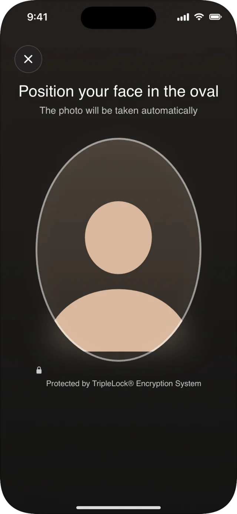
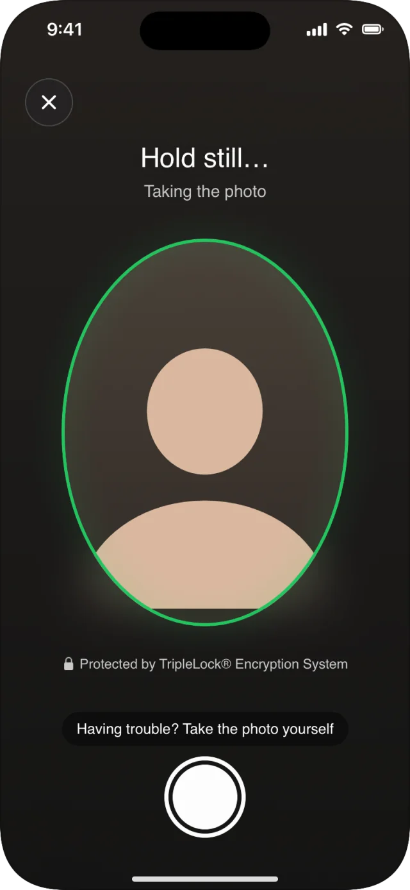
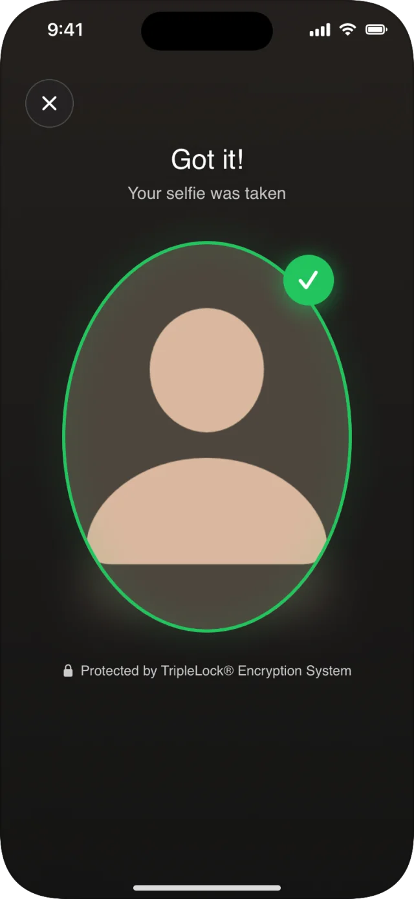

The selfie screen guides the user to a centered, well-framed face and takes the photo automatically. In a [workflow](/integrate/sdks/ios/workflows/run-a-workflow) it follows the document capture, and deepidv matches it against the face on the ID. On its own, `SelfieCaptureView` returns the photo to your app.

## Screens and states

<Frame>
  
  
  
</Frame>

| State | Message | Oval |
|---|---|---|
| No face yet | **Position your face in the oval** · The photo will be taken automatically | White, pulsing |
| Too far | **Move a little closer** · Your face should fill the oval | Blue |
| Off center | **Center your face in the oval** · Look straight at the screen | Blue |
| Several faces | **Only your face, please** · Make sure no one else is in view | Amber |
| Ready | **Hold still…** · Taking the photo | Green |
| Taken | **Got it!** · Your selfie was taken, with the photo frozen in the oval | Green, with a tick |

If the photo hasn't been taken after a few seconds, **Having trouble? Take the photo yourself** and a shutter button appear. The **✕** closes the camera with `.cancelled`. The selfie always uses the front camera.

## On its own: `SelfieCaptureView`

`SelfieCaptureView` doesn't call deepidv. It returns the photo as a `FileInput`, for example to pass to [`verifyIdentity`](/integrate/sdks/ios/headless/document-and-identity).

```swift
SelfieCaptureView { result in
    switch result {
    case .success(let selfie):
        Task {
            let verification = try await client.verifyIdentity(
                documentFront: documentFront, selfie: selfie, type: .driversLicense)
            print("verified:", verification.verified)
        }
    case .failure(let error):
        if error.kind == .cancelled { return }
        print("selfie failed:", error.kind)
    }
}
```

| Parameter | Type | Description |
|---|---|---|
| `onResult` | `(Result<FileInput, DeepIDVError>) -> Void` | Called once with the JPEG, or an error: `.cancelled`, `.cameraPermissionDenied`, `.captureFailed`. |

## Guidance for your users

| Do | Don't |
|---|---|
| Face a window or a soft light | Sit with a bright window or lamp behind you |
| Hold the phone at eye level | Look down at the phone from below |
| Take off sunglasses and hats | Cover part of your face |
| Be the only person in view | Have someone else in the frame |

## Related

- [Face liveness](/integrate/sdks/ios/face-liveness): proves the person is present, beyond a single photo
- [Failures and retries](/integrate/sdks/ios/workflows/failures): selfie failures in workflows
