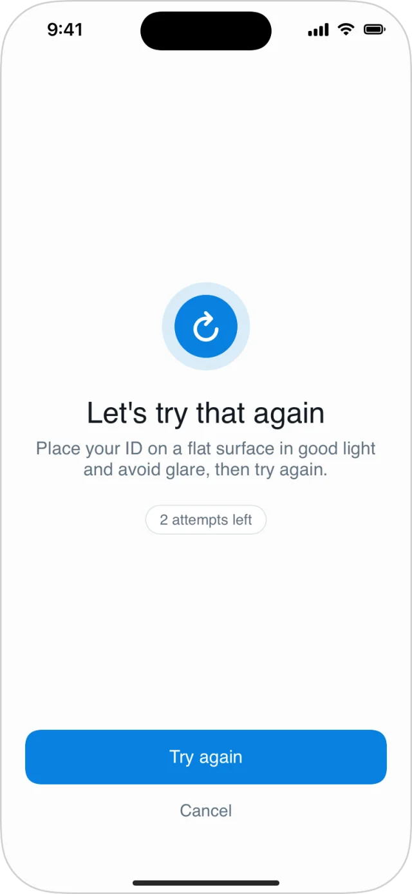

Failures are typed, so you branch on them without parsing strings.

- **`WorkflowFailure`**: why a step's most recent attempt failed. It's on every step outcome (`run.steps[i].failure`), both while the step can still be retried and once it can't.
- **`WorkflowSessionFailure`**: why a run ended without being submitted. It's on `run.sessionFailure`.

## What the SDK does for you

In `DeepIDVWorkflowView`, a failed attempt with attempts left shows a retry screen and redoes only what failed:

| Failure | What the user does next |
|---|---|
| The selfie had no face, several faces, or didn't match the ID | Retakes the selfie only |
| The document type isn't accepted by the workflow | Back to the document picker for that document |
| The document couldn't be read or recognized | Captures the same document type again |
| Liveness didn't pass, or didn't match the ID | Repeats the liveness check, with the reason shown |

<Frame caption="A retry with attempts left.">
  
</Frame>

You only handle failures yourself when the run ends.

## `WorkflowFailure`

| Field | Meaning |
|---|---|
| `code` | The specific cause (below). |
| `category` | `.document`, `.selfie`, `.faceMatch`, `.liveness` or `.other`. |
| `userAction` | `.retakeDocument`, `.useDifferentDocument`, `.retakeSelfie`, `.retryLiveness`, `.retryStep` or `.none`. |
| `isRetryable` | Whether the step can still be submitted again. `false` once attempts run out. |
| `slot` | Which document (`.primary`, `.secondary`, `.tertiary`), when the failure is about one. |
| `message` | A developer description for logs. Never show it to users. |

| `code` | Meaning |
|---|---|
| `.idFaceNotDetected` | No face photo was found on the ID. |
| `.idTextNotReadable` | The text on the ID couldn't be read. |
| `.documentTypeNotAccepted` | The workflow doesn't accept this type of document. |
| `.documentTypeUnrecognized` | The document couldn't be recognized as the selected type. |
| `.documentTypeLowConfidence` | The document type was recognized with too little confidence. |
| `.selfieFaceNotDetected` | No face was found in the selfie. |
| `.selfieMultipleFaces` | More than one face was found in the selfie. |
| `.selfieIDFaceMismatch` | The selfie doesn't match the face on the ID. |
| `.livenessIDMismatch` | The face in the liveness check doesn't match the ID. |
| `.livenessFailed` | The liveness check didn't pass. |
| `.unknown` | The server couldn't classify the failure. |

## `WorkflowSessionFailure`

| `code` | Meaning |
|---|---|
| `.attemptsExhausted` | The session ran out of attempts. `stepID` and `failure` say where and why. |
| `.stepBlocked` | A step failed in a way that can't be retried. |
| `.sessionExpired` | The session expired before it was finished. |

```swift
case .success(let run):
    guard let failure = run.sessionFailure else { return showSubmitted() }
    switch failure.code {
    case .attemptsExhausted:
        log("Out of attempts at \(failure.stepID?.rawValue ?? "?"): \(failure.failure?.code.rawValue ?? "?")")
        showContactSupport()
    case .sessionExpired:
        startNewSession()
    default:
        showContactSupport()
    }
```

## Rules for robust code

- **Codes are open sets.** `WorkflowFailure.Code`, `WorkflowSessionFailure.Code` and `APIErrorCode` are structs, not enums. A newer server can send a code this SDK version doesn't know; it arrives in `rawValue`. Always keep a `default` branch.
- **Prefer `category` and `userAction`** for decisions. They're small and stable.
- **Don't show `message`** to users. Write your own copy from `code` or `userAction`.
- Scores and thresholds aren't exposed to the app.
