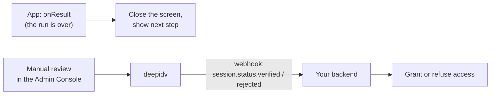

## Where the decision comes from



- **`onResult` says the run is over.** Use it to move your UI on.
- **Your backend gets the decision**, from [webhooks](/webhooks/overview) or [Retrieve session](/api-reference/sessions/retrieve-session). Grant access there.

Two reasons the app can't be the source of truth:

1. Code on the user's device can be modified by the user.
2. The decision can come after the run. Workflows without an automatic decision, and sessions sent to manual review, are decided later in the Admin Console.

## `WorkflowRunResult`

| Property | Type | Meaning |
|---|---|---|
| `sessionID` | `String` | The session that ran. |
| `sessionStatus` | `SessionStatus` | The session's status when the run ended (below). |
| `sessionProgress` | `SessionProgress` | `.pending`, `.started` or `.completed`. |
| `steps` | `[StepOutcome]` | One per workflow step: `stepID`, `status`, `attempts`, and the last `failure` if any. |
| `sessionFailure` | `WorkflowSessionFailure?` | Set when the run ended without being submitted. See [Failures](/integrate/sdks/ios/workflows/failures). |

## `SessionStatus`

The SDK uses the same status words as the API and webhooks.

| Value | Raw value | Meaning |
|---|---|---|
| `.submitted` | `SUBMITTED` | All steps done; the decision is pending (manual review, or checks still running). |
| `.verified` | `VERIFIED` | Approved automatically by the workflow. |
| `.rejected` | `REJECTED` | Declined automatically by the workflow. |
| `.failed` | `FAILED` | The run ended without submission (see `sessionFailure`). |
| `.expired` | `EXPIRED` | The session expired. |
| `.pending` | `PENDING` | Not started. |
| `.completed` | `COMPLETED` | Finished. |

`SessionStatus` is an open set: compare against the constants and keep a `default` branch for values a newer server may send.

```swift
switch run.sessionStatus {
case .verified, .rejected, .submitted:
    showSubmittedScreen()          // the same screen: never reveal the decision in the app
default:
    showTryAgainLater()
}
```

<Note>
  The SDK's closing screen looks the same whatever the decision. Do the same on your own screens unless your product needs to tell users the outcome, and then take it from your backend.
</Note>

## In the Admin Console

Every run creates one session you can open in the Admin Console, with the photos, the extracted fields, face match and liveness results, and the decision reasons. See [Manual review](/review/manual-review).
