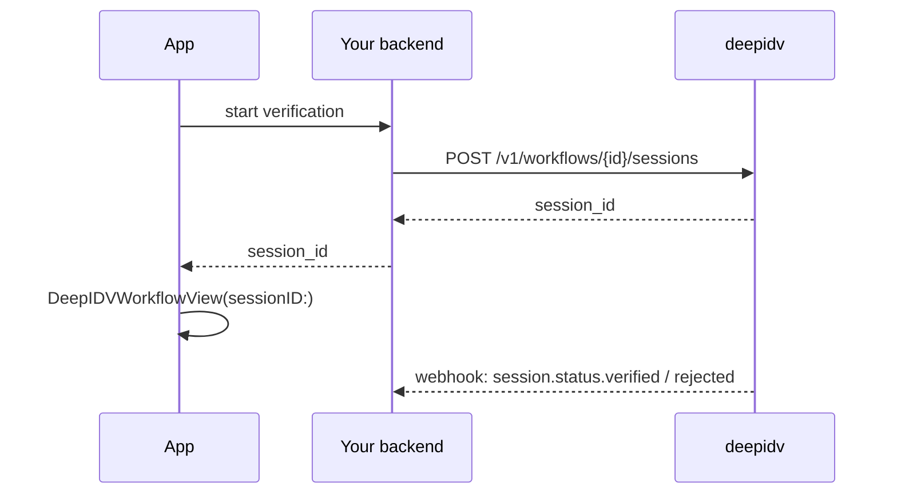
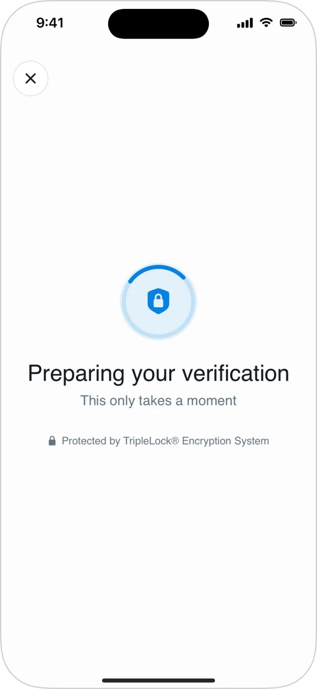
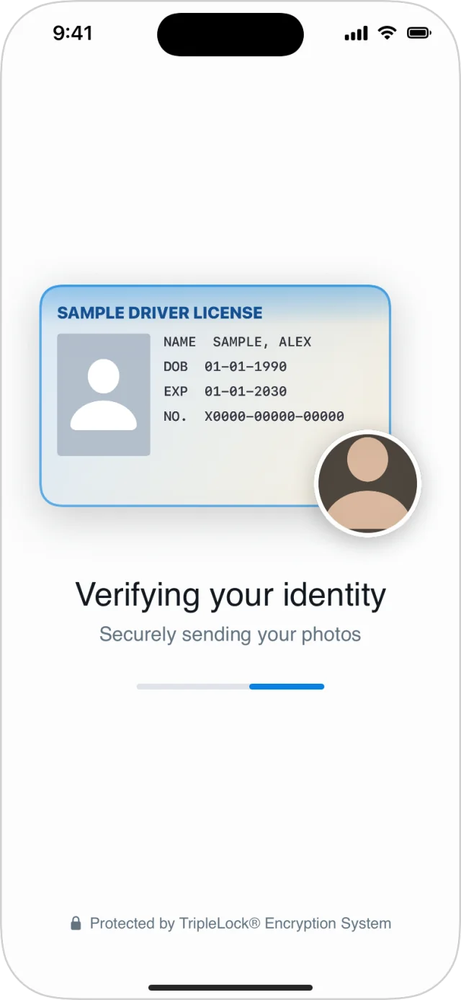
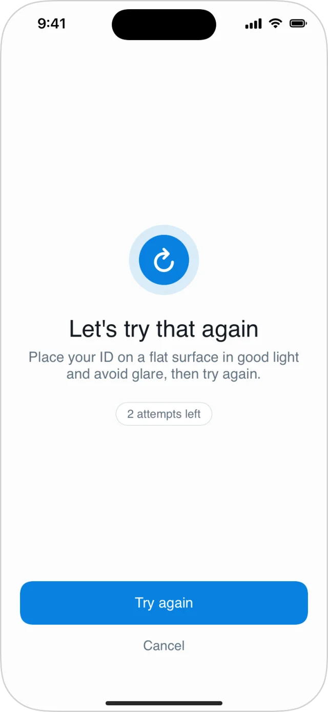
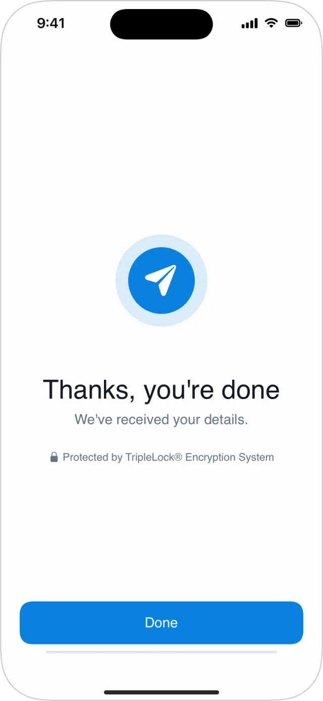

`DeepIDVWorkflowView` runs a workflow you built in the [Admin Console](/workflows/workflows) against one session, step by step, and reports one result when the user is done.

Supported steps: **ID verification** (one, two or three documents) and **face liveness**. A workflow with any other step fails with `.validation` before the camera opens.

## Three ways to start

<Tabs>
  <Tab title="Session from your backend (recommended)">
    Your backend creates the session with [Create workflow session](/api-reference/workflow-runner/create-workflow-session) and passes the app its ID.

    ```swift
    DeepIDVWorkflowView(client: client, sessionID: sessionID) { result in
        // handle the result
    }
    ```

    The session must be new: one that has started or finished fails with `.conflict`. To continue a started session, resume it.
  </Tab>
  <Tab title="Let the view create it">
    The view creates the session from the app. The user's details are sent from the device.

    ```swift
    DeepIDVWorkflowView(
        client: client,
        workflowID: "YOUR_WORKFLOW_ID",
        user: WorkflowUser(
            email: "jane.doe@example.com",
            firstName: "Jane",
            lastName: "Doe",
            phone: "+14155552671",    // optional, E.164
            externalID: "user_12345"  // optional, your own ID
        )
    ) { result in
        // handle the result
    }
    ```
  </Tab>
  <Tab title="Resume a session">
    Continue a session that started but didn't finish. See [Resuming](/integrate/sdks/ios/workflows/resuming).

    ```swift
    DeepIDVWorkflowView(client: client, resumingSessionID: sessionID) { result in
        // handle the result
    }
    ```
  </Tab>
</Tabs>

Every initializer also takes `documentCamera:` to choose the camera for this view only. See [Camera](/integrate/sdks/ios/camera).

### Sessions from your backend

Creating the session on your backend keeps the user's details on your server, ties the session to a signed-in user, and lets your [proxy](/integrate/sdks/ios/proxy-mode) refuse requests for anyone else's session.



## Present it full screen

The view fills the screen and runs the camera. Present it with `fullScreenCover` (SwiftUI) or a full-screen `UIHostingController` (UIKit), and close it from `onResult`.

```swift
.fullScreenCover(isPresented: $isVerifying) {
    DeepIDVWorkflowView(client: client, sessionID: sessionID) { result in
        isVerifying = false
        // handle the result
    }
}
```

```swift UIKit
let controller = UIHostingController(
    rootView: DeepIDVWorkflowView(client: client, sessionID: sessionID) { [weak self] result in
        self?.dismiss(animated: true)
        // handle the result
    }
)
controller.modalPresentationStyle = .fullScreen
present(controller, animated: true)
```

## What the user sees

<Frame caption="Around the steps: preparing, sending, a retry, and the closing screen.">
  
  
  
  
</Frame>

| Moment | Screen | Notes |
|---|---|---|
| Opening | **Preparing your verification** | Fetches the workflow and starts the session. A resumed session shows **Picking up where you left off**. |
| ID verification | Document picker, then the [document camera](/integrate/sdks/ios/document-capture), then the [selfie](/integrate/sdks/ios/selfie) | The picker lists only the document types the workflow accepts, and is skipped when it accepts just one. Cards are captured front and back unless the workflow marks the type front-only; passports are always front-only. A second or third document repeats the picker. |
| Sending | **Verifying your identity** | Shows the ID and selfie just taken while the photos upload. |
| A check fails | Retry screen with the attempts left | The SDK retakes only what failed: the selfie, or the document with the same type, or returns to the picker if the type isn't accepted. See [Failures](/integrate/sdks/ios/workflows/failures). |
| Face liveness | The [liveness check](/integrate/sdks/ios/face-liveness) | |
| Done | **Thanks, you're done** | The same whatever the decision, so it never tells the user whether they passed. Closes after 3 seconds or with **Done**, then `onResult` fires. |
| Error | Error screen | Network and server errors offer **Try again**, which continues from the current step. |

To skip the closing screen and return to your app straight away, set `showsCompletionScreen` to `false` in [`DeepIDVConfig`](/integrate/sdks/ios/reference/configuration).

## Handle the result

`onResult` fires exactly once, with a `Result<WorkflowRunResult, DeepIDVError>`.

```swift
DeepIDVWorkflowView(client: client, sessionID: sessionID) { result in
    switch result {
    case .success(let run):
        if let failure = run.sessionFailure {
            // The run ended without being submitted, e.g. attempts ran out.
            showMessage(for: failure.code)
        } else {
            showSubmittedScreen()   // the decision arrives on your backend
        }
    case .failure(let error):
        switch error.kind {
        case .cancelled:
            break                    // the user closed it
        case .cameraPermissionDenied:
            showCameraHelp()
        default:
            showGenericError()
        }
    }
}
```

- `.success` means the run ended normally: submitted, or out of attempts (`sessionFailure` is set).
- `.failure` is for errors: network, permissions, cancellation, a session that can't run.

Details: [Results and the decision](/integrate/sdks/ios/workflows/results), [Failures](/integrate/sdks/ios/workflows/failures), [Errors](/integrate/sdks/ios/reference/errors).

## Headless session calls

To inspect or drive a session without UI:

| Method | Does |
|---|---|
| `createWorkflowSession(workflowID:user:expiresInHours:)` | Creates a session (prefer your backend). |
| `startWorkflowSession(sessionID:)` | Starts it. |
| `resumeWorkflowSession(sessionID:)` | Returns where an unfinished session stands. |
| `fetchWorkflowState(sessionID:)` | Reads the state of any session, finished or not. |

Each returns a `WorkflowExecutionState` (or `WorkflowSession` for create) with the steps, their status, attempts left and failures.
